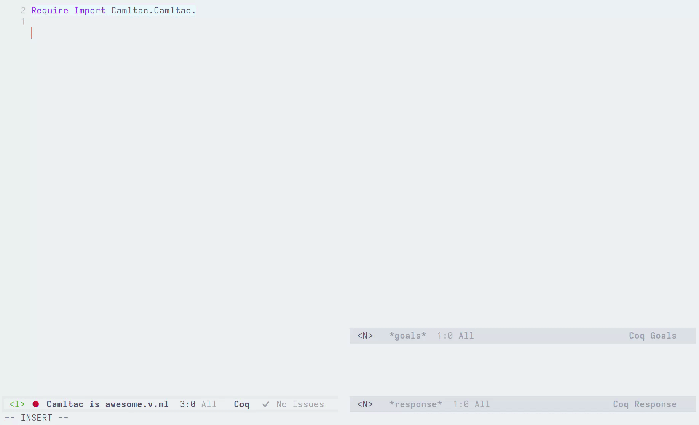

How to configure your editor
============================

.. attention::

   Editor support is a work-in-progress; in the meantime, the following page describes the current solutions.

Emacs
-----

Here is a setup that works relatively well. It provides autocomplete for Rocq and Ltac2 APIs, but does not provide autocomplete for Camltac modules or other packages.

This setup is based on the OCaml language server and requires:

* `polymode` installed (:kbd:`M\-x package\-install RET polymode RET`);
* You must *not* use `.merlin` files (we use a `.merlin` file to provide custom information to the language server);
* Your filenames must end with `.v.ml` (the OCaml language server only accepts `.ml` files).

Copy the following code to your Emacs configuration:

.. code-block:: lisp
   :caption: init.el

   (use-package polymode
     :mode ("\\.v\\.ml$" . poly-camltac-mode)
     :config
     (define-hostmode poly-camltac-hostmode :mode 'coq-mode)
     (define-innermode poly-camltac-ocaml-innermode
                       :mode 'tuareg-mode
                       :head-matcher (rx "ocaml:{{")
                       :tail-matcher (rx "}}")
                       :head-mode 'host
                       :tail-mode 'host)
     (define-polymode poly-camltac-mode
                      :hostmode 'poly-camltac-hostmode
                      :innermodes '(poly-camltac-ocaml-innermode)))

In the root of your project, create a `.merlin` file with the following contents:

.. code-block:: text
   :caption: .merlin

   S */*.v
   B .camltac/modules
   PKG rocq-runtime.boot   
   PKG rocq-runtime.checklib 
   PKG rocq-runtime.clib   
   PKG rocq-runtime.config 
   PKG rocq-runtime.config.byte 
   PKG rocq-runtime.coqargs 
   PKG rocq-runtime.coqdeplib 
   PKG rocq-runtime.coqworkmgrapi 
   PKG rocq-runtime.dev    
   PKG rocq-runtime.engine 
   PKG rocq-runtime.gramlib 
   PKG rocq-runtime.interp 
   PKG rocq-runtime.kernel 
   PKG rocq-runtime.lib    
   PKG rocq-runtime.library 
   PKG rocq-runtime.parsing 
   PKG rocq-runtime.perf   
   PKG rocq-runtime.plugins 
   PKG rocq-runtime.plugins.btauto 
   PKG rocq-runtime.plugins.cc 
   PKG rocq-runtime.plugins.cc_core 
   PKG rocq-runtime.plugins.derive 
   PKG rocq-runtime.plugins.extraction 
   PKG rocq-runtime.plugins.firstorder 
   PKG rocq-runtime.plugins.firstorder_core 
   PKG rocq-runtime.plugins.funind 
   PKG rocq-runtime.plugins.ltac 
   PKG rocq-runtime.plugins.ltac2 
   PKG rocq-runtime.plugins.ltac2_ltac1 
   PKG rocq-runtime.plugins.micromega 
   PKG rocq-runtime.plugins.micromega_core 
   PKG rocq-runtime.plugins.nsatz 
   PKG rocq-runtime.plugins.nsatz_core 
   PKG rocq-runtime.plugins.number_string_notation 
   PKG rocq-runtime.plugins.ring 
   PKG rocq-runtime.plugins.rtauto 
   PKG rocq-runtime.plugins.ssreflect 
   PKG rocq-runtime.plugins.ssreflect_rewrite 
   PKG rocq-runtime.plugins.ssrmatching 
   PKG rocq-runtime.plugins.tauto 
   PKG rocq-runtime.plugins.zify 
   PKG rocq-runtime.pretyping 
   PKG rocq-runtime.printing 
   PKG rocq-runtime.proofs 
   PKG rocq-runtime.rocqshim 
   PKG rocq-runtime.stm    
   PKG rocq-runtime.sysinit 
   PKG rocq-runtime.tactics 
   PKG rocq-runtime.toplevel 
   PKG rocq-runtime.vernac 
   PKG rocq-runtime.vm
   PKG ppx_rocq.runtime
   PKG rocq-camltac.plugin.runtime
   PKG rocq-camltac.plugin.api
   FLG -open Api
   FLG -open Prelude
   FLG -short-paths
   FLG -no-alias-deps
   FLG -pp 'ppx_rocq -as-pp --use-compiler-pp --cookie ppx_rocq.camltac_mode=true'

Type `ocaml:{{` and see it in action:

VSCode
------

Currently, we do not have specialized support for Camltac in VSRocq, but we would like to in the near-future. If you are interested in implementing such a feature, please `reach out`_!

.. _reach out: https://github.com/epfl-systemf/camltac
